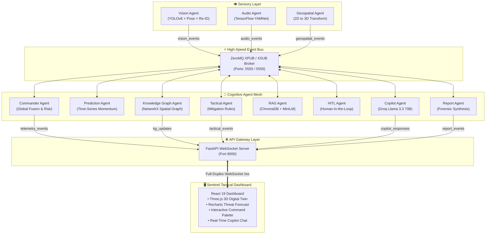

<div align="center">

# 🛡️ THREAT-AI : Sentinel-X
### *Autonomous Multi-Agent Tactical Defense & Situational Awareness Intelligence Platform*

[](https://python.org)
[](https://react.dev)
[](https://fastapi.tiangolo.com)
[](https://zeromq.org)
[](https://ultralytics.com)
[](https://groq.com)
[](LICENSE)

<br/>

**THREAT-AI (Sentinel-X)** is an enterprise-grade, edge-compatible situational intelligence platform. By unifying **multimodal sensor streams** (pose estimation, audio classification, spatial tracking) with a **distributed cognitive agent swarm** (RAG, dynamic knowledge graphs, predictive risk forecasting, tactical planning), Sentinel-X delivers millisecond-level threat detection, intent escalation tracking, and automated emergency mitigations.

[System Architecture](#-system-architecture) • [Key Capabilities](#-key-capabilities) • [Agent Ecosystem](#-agent-ecosystem) • [Quickstart Guide](#-quickstart-guide) • [Event Topics](#-event-bus-architecture)

</div>

---

## 🌟 Executive Summary

Traditional security surveillance systems suffer from latency, alert fatigue, and blind spots. **THREAT-AI** resolves this through an autonomous **Distributed Multi-Agent Architecture**:
- **Sensory Agents** ingest video feeds, run YOLOv8 skeletal pose tracking, re-identify subjects across occlusions, and detect acoustic anomalies (gunshots, glass break, screaming).
- **Cognitive Agents** ingest raw events via a high-throughput **ZeroMQ Pub/Sub Broker**, compute time-series threat velocity, match behaviors against vectorized **Standard Operating Procedures (ChromaDB RAG)**, and dynamically maintain an **entity-relationship knowledge graph**.
- **The Commander Copilot** (powered by **Llama 3.3 70B via Groq**) synthesizes situational context to deliver instant tactical courses of action.
- **The Sentinel Dashboard** renders a 3D digital twin (Three.js/WebGL), predictive risk trajectory curves, and real-time interactive command palettes.

---

## 🏛 System Architecture



---

## 🚀 Key Capabilities

### 1. Vision Intelligence & Biometric Kinematics
- **YOLOv8 Pose Estimation**: Extracts 17 body keypoints in real time to calculate joint angles, arm elevations, and stance velocity.
- **Intent Escalation Detection**: Tracks temporal transitions between `NEUTRAL` ➔ `AGGRESSIVE` ➔ `SURRENDER`.
- **Identity Persistence (Re-ID)**: HSV color-histogram visual fingerprinting that re-associates track IDs when subjects exit and re-enter the camera view.
- **Weapon & Object Detection**: Real-time detection of bladed weapons and suspicious handheld objects.
- **Ethical Privacy Guardrails**: Optional facial region blurring for privacy compliance.

### 2. Acoustic Threat Classification
- **TensorFlow YAMNet**: Classifies 521 audio event categories, instantly identifying gunshots, explosions, screams, glass breaking, and shouts.
- **Real-Time Audio Stream Processing**: Direct audio capture using `sounddevice` with adaptive noise rejection.

### 3. Predictive Threat Momentum
- **Time-Series Horizon Forecasting**: Calculates velocity of risk escalation and projects risk scores into the future (**+10s, +30s, +1m, +5m, +15m**).
- **Volatility Uncertainty Bands**: Dynamically adjusts confidence intervals based on situation volatility.

### 4. Dynamic Knowledge Graph
- **Entity-Relationship Tracking**: Models connections in real time: `[Person] ➔ [INVOLVED_IN] ➔ [Event_Aggression]`, `[Person] ➔ [LOCATED_IN] ➔ [Sector_North]`.
- Continuously serializes and streams graph updates to the UI for topological threat visibility.

### 5. Tactical RAG & Standard Operating Procedures
- **ChromaDB Vector Store**: Semantic retrieval of security SOPs (e.g., lockdown triggers, evacuation pathways, rules of engagement).
- Grounded context delivered directly to autonomous agents and human incident commanders.

### 6. Interactive 3D Digital Twin
- **Three.js & React Three Fiber**: Transforms 2D bounding boxes into real-world 3D coordinates.
- Displays interactive facility zones, live human spatial markers, and color-coded risk sectors.

---

## 🤖 Agent Ecosystem

| Agent | Module | Primary Role | Ingests | Emits |
|---|---|---|---|---|
| **Vision Agent** | `agents/vision_agent.py` | YOLOv8 Pose, Object & Re-ID Tracking | Camera Stream | `vision_events` |
| **Audio Agent** | `agents/audio_agent.py` | Acoustic anomaly & sound event detection | Microphone Stream | `audio_events` |
| **Geospatial Agent** | `agents/geospatial_agent.py` | 2D camera coordinates to 3D world projection | `vision_events` | `geospatial_events` |
| **Commander Agent** | `agents/commander_agent.py` | Central telemetry fusion & risk scoring (0-100) | All sensor events | `telemetry_events` |
| **Prediction Agent** | `agents/prediction_agent.py` | Time-series risk trajectory forecasting | `telemetry_events` | `forecast_events` |
| **Knowledge Graph** | `agents/knowledge_graph_agent.py` | Entity-relationship graph state maintenance | `vision_events`, `geospatial_events` | `kg_updates` |
| **Tactical Agent** | `agents/tactical_agent.py` | Automated mitigation plan generation | `telemetry_events` | `tactical_events` |
| **RAG Agent** | `agents/rag_agent.py` | Vector search over security SOP protocols | `rag_query` | `rag_response` |
| **HITL Agent** | `agents/hitl_agent.py` | Operator confirmation & false-alarm triage | `dashboard_commands` | `hitl_events`, `system_commands` |
| **Report Agent** | `agents/report_agent.py` | Post-incident forensic summary generation | `telemetry_events` | `report_events` |
| **Reasoning Agent** | `reasoning_agent.py` | Standalone Groq Llama 3.3 tactical planner | Critical ZMQ alerts | Console / Broadcast |

---

## 📂 Repository Structure

```text
THREAT-AI/
├── agents/                       # Distributed Cognitive & Sensory Agents
│   ├── audio_agent.py            # YAMNet acoustic anomaly classifier
│   ├── commander_agent.py        # Central fusion engine & copilot responder
│   ├── geospatial_agent.py       # 2D-to-3D projection agent
│   ├── hitl_agent.py             # Human-in-the-Loop approval agent
│   ├── knowledge_graph_agent.py  # NetworkX entity relationship builder
│   ├── prediction_agent.py       # Time-series momentum forecasting
│   ├── rag_agent.py              # ChromaDB vector retrieval for SOPs
│   ├── report_agent.py           # Automated incident reporting agent
│   ├── tactical_agent.py         # Autonomous mitigation strategy planner
│   └── vision_agent.py           # YOLOv8 pose, kinematics & identity tracking
├── core/                         # Messaging Fabric
│   ├── broker.py                 # ZeroMQ XPUB/XSUB Message Broker
│   └── event_bus.py              # ZeroMQ Pub/Sub wrapper interface
├── gateway/                      # Async API Gateway
│   └── main.py                   # FastAPI + WebSocket server
├── sentinel-dashboard/           # Tactical React 19 Frontend
│   ├── src/
│   │   ├── components/           # 3D Digital Twin, XAI, Copilot & Charts
│   │   ├── useThreatSocket.js    # Resilient WebSocket state hook
│   │   ├── App.jsx               # Main situational layout
│   │   └── index.css             # Cyberpunk design system & tokens
│   ├── package.json              # Dashboard dependencies (React 19, Three.js)
│   └── vite.config.js            # Vite build configuration
├── .env.example                  # Environment configuration template
├── .gitignore                    # Master git exclusion rules
├── check_mic.py                  # Microphone hardware diagnosis utility
├── docker-compose.yml            # Docker services (Redis)
├── LICENSE                       # MIT License
├── reasoning_agent.py            # Dedicated LLM tactical reasoning node
├── requirements.txt              # Production Python dependencies
├── start_all.ps1                 # Windows PowerShell one-click launcher
└── start_all.sh                  # Linux / macOS Bash one-click launcher
```

---

## ⚡ Quickstart Guide

### 1. Prerequisites
- **Python**: `3.10` or newer
- **Node.js**: `18.x` or newer (with `npm`)
- **Webcam**: Standard USB or built-in webcam
- **Groq API Key**: Free API key from [Groq Console](https://console.groq.com/keys)

---

### 2. Clone & Environment Setup

```bash
# Clone the repository
git clone https://github.com/vedantvk12/THREAT-AI.git
cd THREAT-AI

# Create and activate Python virtual environment
python -m venv venv

# Windows:
.\venv\Scripts\activate
# Linux/macOS:
source venv/bin/activate

# Install backend dependencies
pip install -r requirements.txt
```

---

### 3. Configure Environment Variables

Copy `.env.example` to `.env` and insert your credentials:

```bash
cp .env.example .env
```

Open `.env` and set your Groq API Key:
```env
GROQ_API_KEY=gsk_your_actual_groq_key_here
GROQ_MODEL=llama-3.3-70b-versatile
```

---

### 4. Setup React 19 Tactical Dashboard

```bash
cd sentinel-dashboard
npm install
cd ..
```

---

### 5. Launch Sentinel-X

#### Option A: Windows (One-Click Launch)
```powershell
.\start_all.ps1
```
Then start the frontend:
```bash
cd sentinel-dashboard
npm run dev
```

#### Option B: Linux / macOS (One-Click Launch)
```bash
chmod +x start_all.sh
./start_all.sh
```
In a new terminal window:
```bash
cd sentinel-dashboard
npm run dev
```

#### Option C: Manual Launch (Step-by-Step)
If you prefer running services in separate terminal windows:
```bash
# 1. Start Message Broker
python core/broker.py

# 2. Start API Gateway
python gateway/main.py

# 3. Start Cognitive Agents
python agents/commander_agent.py
python agents/rag_agent.py
python agents/knowledge_graph_agent.py
python agents/prediction_agent.py
python agents/tactical_agent.py

# 4. Start Vision Sensory Agent
python agents/vision_agent.py

# 5. Start Dashboard
cd sentinel-dashboard && npm run dev
```

Open your browser at **`http://localhost:5173`** to access the tactical operations dashboard.

---

## 📡 Event Bus Architecture

Sentinel-X agents communicate via non-blocking Pub/Sub on top of ZeroMQ:

| Channel / Topic | Producer | Consumer | Payload Description |
|---|---|---|---|
| `vision_events` | Vision Agent | Commander, KG, Geospatial | Detections, pose keypoints, intent label, bounding boxes |
| `audio_events` | Audio Agent | Commander | Classified audio anomaly, top sound class, confidence |
| `geospatial_events` | Geospatial Agent | Commander, KG | Transformed 3D spatial coordinates `[X, Y, Z]` |
| `telemetry_events` | Commander Agent | Gateway, Prediction, Tactical | Global fused state, current risk score (0-100), active alerts |
| `forecast_events` | Prediction Agent | Commander, Gateway | Multi-horizon risk projections (+10s, +30s, +1m, +5m, +15m) |
| `kg_updates` | Knowledge Graph | Gateway | Graph nodes and directed edges for spatial entity network |
| `tactical_events` | Tactical Agent | Gateway | Recommended mitigations (Lockdowns, Evacuations, Dispatches) |
| `copilot_queries` | Gateway | Commander Copilot | Natural language operator prompt from dashboard |
| `copilot_responses`| Commander Copilot | Gateway | LLM tactical analysis and situation breakdown |
| `dashboard_commands`| Gateway | HITL Agent | Operator override (`CONFIRM_THREAT`, `FALSE_ALARM`) |
| `report_events` | Report Agent | Gateway | Formal post-incident forensic telemetry summary |

---

## 🔒 Security & Privacy Practices

- **Zero Hardcoded Secrets**: All API credentials and endpoints are loaded dynamically from environment variables and `.env` files.
- **Git Hygiene**: Comprehensive `.gitignore` prevents virtual environments, temporary caches, and personal API keys from reaching public repositories.
- **Privacy Mode Filter**: The Vision Agent includes a built-in privacy transformation that automatically masks facial features when running in sensitive environments.
- **Human-in-the-Loop Validation**: Tactical countermeasures require human operator confirmation before dispatching physical actuators or notifications.

---

## 🤝 Contributing

Contributions make the open-source community an incredible place to learn, inspire, and create. Any contributions you make are **greatly appreciated**.

Please review [CONTRIBUTING.md](CONTRIBUTING.md) for details on submitting pull requests, coding conventions, and testing guidelines.

---

## 📄 License

Distributed under the **MIT License**. See [LICENSE](LICENSE) for more information.

---

<div align="center">

**Built with precision by [Vedant Kirange](https://github.com/vedantvk12)**

*Advancing the future of Autonomous Tactical AI and Multimodal Defense Systems.*

</div>
